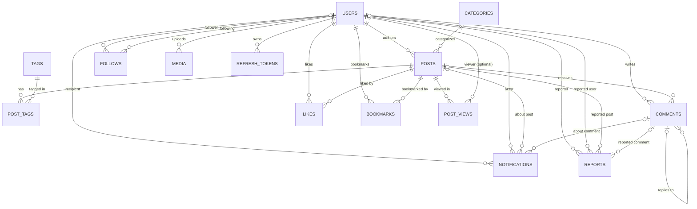

# Inkly Database Schema Documentation

This document describes the **actual, current** database design of the Inkly backend. It is generated by reading the schema source of truth (`src/db/schema/**/*.ts`), the database configuration, and the generated migrations. Nothing in this document is invented: every table, column, index, constraint, enum and relationship below exists in the code.

---

## Metadata

| Item | Value |
| ---- | ----- |
| Database technology | PostgreSQL |
| ORM / query builder | Drizzle ORM (`drizzle-orm` `^1.0.0-rc.4`) with `drizzle-kit` |
| Driver | `node-postgres` (`pg` `Pool`) |
| Schema location | `src/db/schema/` (glob `./src/db/schema/**/*.ts`) |
| Migration output | `drizzle/` (SQL migrations + `snapshot.json` per migration) |
| DB connection | `src/db/index.ts` via `DATABASE_URL` from `src/config/env.ts` |
| Migration config | `drizzle.config.ts` (dialect `postgresql`) |
| Relational query relations | **None defined** — no `relations()` declarations exist in the codebase. Relationships are expressed only through foreign keys and query joins. |

### Last inspected files

Schema source (`src/db/schema/`):

- `users.ts`
- `posts.ts`
- `categories.ts`
- `tags.ts`
- `post_tags.ts`
- `comments.ts`
- `likes.ts`
- `bookmarks.ts`
- `follows.ts`
- `notifications.ts`
- `media.ts`
- `post_views.ts`
- `reports.ts`
- `refresh_tokens.ts`

Configuration / supporting files:

- `src/db/index.ts` (Drizzle + `pg` Pool setup)
- `src/config/env.ts` / `src/config/env.schema.ts` (environment configuration; secrets are **not** reproduced here)
- `drizzle.config.ts`
- `package.json`
- `drizzle/**/migration.sql` (used only to confirm columns, indexes and FK actions)
- `INKLY_PROJECT_CONTEXT.md` (design intent)

---

## Database Overview

Inkly is a blogging platform with social and moderation features on top of a PostgreSQL database accessed through Drizzle ORM.

**Central entity: `users`.** Almost every other table either belongs to a user or links two users/posts together.

Users can (relationships that actually exist in the schema):

- be an **author** of many `posts` (`posts.author_id`)
- write many `comments` (`comments.user_id`)
- **like** many `posts` (`likes`)
- **bookmark** many `posts` (`bookmarks`)
- **follow** other users (`follows.follower_id` → `follows.following_id`)
- receive and trigger `notifications` (`notifications.recipient_id`, `notifications.actor_id`)
- upload `media` (`media.uploaded_by`)
- generate `post_views` (`post_views.user_id`, optional/anonymous allowed)
- file and be the target of `reports` (`reports.reporter_id`, `reports.reported_user_id`)
- own `refresh_tokens` (`refresh_tokens.user_id`)

Posts are the second hub. A post:

- belongs to exactly one **author** (`users`) and exactly one **category** (`categories`)
- can have **many tags** through `post_tags`
- has **many comments**, **likes**, **bookmarks**, and **views**
- can be linked to **notifications** and **reports**

### Core relationships

- One `users` row → many `posts`, `comments`, `likes`, `bookmarks`, `media`, `refresh_tokens`, `post_views`, `reports`, `notifications`.
- One `categories` row → many `posts` (one category per post).
- `posts` ↔ `tags`: many-to-many through `post_tags`.
- `users` ↔ `users`: self-referencing many-to-many through `follows`.
- `comments` ↔ `comments`: self-referencing one-to-many (replies) through `parent_id`.
- `likes` and `bookmarks` are pure many-to-many join tables between `users` and `posts`.

### General architecture

- **Normalized blogging core:** `users`, `categories`, `tags`, `posts`, `post_tags`.
- **Engagement layer:** `comments`, `likes`, `bookmarks`, `post_views`.
- **Social layer:** `follows`, `notifications`.
- **Moderation layer:** `reports` plus post review workflow fields.
- **Auth layer:** `users` credentials/role + `refresh_tokens` for rotating sessions.
- **Media layer:** `media` for uploaded assets, plus Cloudinary-style cover image fields on `posts`.
- **Referential integrity is enforced by the database** through foreign keys with explicit `ON DELETE` actions; integrity policies are described per table below.

---

## users table

**Purpose:** Stores application user accounts (identity, credentials, profile, role and verification state).

**Related entities:** `posts`, `comments`, `likes`, `bookmarks`, `follows`, `notifications`, `media`, `post_views`, `reports`, `refresh_tokens`.

**File:** `src/db/schema/users.ts`

### Columns

| Column | Type | Nullable | Default | Description |
| ------ | ---- | -------- | ------- | ----------- |
| `id` | `uuid` | No (PK) | `gen_random_uuid()` | Primary key. |
| `email` | `text` | Yes | — | Login email; unique when present. |
| `phone` | `text` | Yes | — | Login phone; unique when present. Reserved for future phone OTP. |
| `username` | `varchar(50)` | No | — | Unique public handle. |
| `password_hash` | `text` | Yes | — | Hashed password (Argon2 is used by the app). Nullable to allow future passwordless flows. |
| `display_name` | `varchar(50)` | No | — | Name shown in the UI. |
| `avatar_url` | `text` | Yes | — | Profile image URL. |
| `bio` | `text` | Yes | — | Short user biography. |
| `role` | `user_role` enum | No | `'USER'` | Authorization role. |
| `created_at` | `timestamp` | No | `now()` | Row creation time. |
| `updated_at` | `timestamp` | No | `now()` | Last update time (see quality review re: auto-update). |
| `email_verified_at` | `timestamp` | Yes | — | Email verification timestamp. |
| `phone_verified_at` | `timestamp` | Yes | — | Phone verification timestamp. |

### Primary Keys

- `id`
- Type: `uuid`
- Generation: application/DB default `gen_random_uuid()` via `.defaultRandom()`.

### Foreign Keys

None. `users` is a root entity.

### Indexes

- Primary key index on `id` (implicit).
- Unique indexes on `email`, `phone`, `username` (implicit, created by `UNIQUE`).

No additional explicit indexes are declared. Note: PostgreSQL allows multiple `NULL`s in a unique column, so several users may have `NULL` email/phone.

### Constraints

- **Unique:** `email`, `phone`, `username`.
- **Not null:** `username`, `display_name`, `role`, `created_at`, `updated_at`.
- **Enum:** `role` ∈ `{ ADMIN, USER, AUTHOR }` (PostgreSQL type `user_role`).

### Relationships

```
users
One-to-many:
users -> posts            (posts.author_id)

One-to-many:
users -> comments         (comments.user_id)

One-to-many:
users -> likes            (likes.user_id)

One-to-many:
users -> bookmarks        (bookmarks.user_id)

One-to-many (two roles):
users -> follows          (follows.follower_id, follows.following_id)

One-to-many (two roles):
users -> notifications    (notifications.recipient_id, notifications.actor_id)

One-to-many:
users -> media            (media.uploaded_by)

One-to-many (optional):
users -> post_views       (post_views.user_id)

One-to-many (two roles):
users -> reports          (reports.reporter_id, reports.reported_user_id)

One-to-many:
users -> refresh_tokens   (refresh_tokens.user_id)
```

---

## posts table

**Purpose:** Stores blog articles created by authors, including the review/publishing workflow and SEO/cover-image metadata.

**Related entities:** `users`, `categories`, `tags` (via `post_tags`), `comments`, `likes`, `bookmarks`, `post_views`, `notifications`, `reports`.

**File:** `src/db/schema/posts.ts`

### Columns

| Column | Type | Nullable | Default | Description |
| ------ | ---- | -------- | ------- | ----------- |
| `id` | `uuid` | No (PK) | `gen_random_uuid()` | Primary key. |
| `author_id` | `uuid` | No | — | FK → `users.id`. Post author. |
| `category_id` | `uuid` | No | — | FK → `categories.id`. One category per post. |
| `title` | `text` | No | — | Post title. |
| `excerpt` | `text` | Yes | — | Optional short summary/teaser. |
| `slug` | `text` | No | — | Unique SEO-friendly URL slug. |
| `content` | `text` | No | — | Full post body. |
| `seo_title` | `text` | Yes | — | Optional SEO title override. |
| `seo_description` | `text` | Yes | — | Optional SEO meta description. |
| `status` | `post_status` enum | No | `'DRAFT'` | Workflow state. |
| `cover_image_url` | `text` | Yes | — | Cover image URL (Cloudinary-style). |
| `cover_image_public_id` | `text` | Yes | — | Storage public id for cover image. |
| `cover_image_alt` | `text` | Yes | — | Cover image alt text. |
| `published_at` | `timestamp` | Yes | — | When the post was published. |
| `created_at` | `timestamp` | No | `now()` | Row creation time. |
| `updated_at` | `timestamp` | No | `now()` | Last update time. |
| `rejection_reason` | `text` | Yes | — | Reason recorded when a post is rejected. |

### Primary Keys

- `id` (`uuid`), generated with `gen_random_uuid()` (`.defaultRandom()`).

### Foreign Keys

`author_id` → `users.id`

- On delete: **cascade** (deleting a user deletes their posts).

`category_id` → `categories.id`

- On delete: **restrict** (a category cannot be deleted while posts reference it).

### Indexes

- `posts_author_id_idx` — index on `author_id`; speeds up "posts by author" queries.
- `posts_category_id_idx` — index on `category_id`; speeds up "posts in category" queries.
- `posts_status_published_at_idx` — composite index on `(status, published_at)`; used for fast published-post listing/ordering.
- Unique index on `slug` (implicit).

### Constraints

- **Unique:** `slug`.
- **Not null:** `author_id`, `category_id`, `title`, `slug`, `content`, `status`, `created_at`, `updated_at`.
- **Enum:** `status` ∈ `{ DRAFT, PENDING_REVIEW, APPROVED, PUBLISHED, REJECTED }` (type `post_status`).

### Relationships

```
posts
Many-to-one:
posts -> users        (posts.author_id)

Many-to-one:
posts -> categories   (posts.category_id)

Many-to-many:
posts <-> tags        (through post_tags)

One-to-many:
posts -> comments         (comments.post_id)

One-to-many:
posts -> likes            (likes.post_id)

One-to-many:
posts -> bookmarks        (bookmarks.post_id)

One-to-many:
posts -> post_views       (post_views.post_id)

One-to-many (optional):
posts -> notifications    (notifications.post_id)

One-to-many (optional):
posts -> reports          (reports.post_id)
```

---

## categories table

**Purpose:** Stores the single category each post belongs to.

**Related entities:** `posts`.

**File:** `src/db/schema/categories.ts`

### Columns

| Column | Type | Nullable | Default | Description |
| ------ | ---- | -------- | ------- | ----------- |
| `id` | `uuid` | No (PK) | `gen_random_uuid()` | Primary key. |
| `name` | `varchar(50)` | No | — | Display name. |
| `description` | `text` | Yes | — | Optional description. |
| `slug` | `varchar(100)` | No | — | Unique URL slug. |
| `created_at` | `timestamp` | No | `now()` | Row creation time. |
| `updated_at` | `timestamp` | No | `now()` | Last update time. |

### Primary Keys

- `id` (`uuid`), `gen_random_uuid()`.

### Foreign Keys

None.

### Indexes

- Primary key index on `id` (implicit).
- Unique index on `slug` (implicit).

Note: `name` is **not** unique, so duplicate category names are possible while slugs remain unique.

### Constraints

- **Unique:** `slug`.
- **Not null:** `name`, `slug`, `created_at`, `updated_at`.

### Relationships

```
categories
One-to-many:
categories -> posts   (posts.category_id)
```

---

## tags table

**Purpose:** Stores reusable tags that can be attached to many posts.

**Related entities:** `posts` (through `post_tags`).

**File:** `src/db/schema/tags.ts`

### Columns

| Column | Type | Nullable | Default | Description |
| ------ | ---- | -------- | ------- | ----------- |
| `id` | `uuid` | No (PK) | `gen_random_uuid()` | Primary key. |
| `name` | `varchar(50)` | No | — | Unique tag name. |
| `slug` | `varchar(100)` | No | — | Unique tag slug. |
| `created_at` | `timestamp` | No | `now()` | Row creation time. |
| `updated_at` | `timestamp` | No | `now()` | Last update time. |

### Primary Keys

- `id` (`uuid`), `gen_random_uuid()`.

### Foreign Keys

None.

### Indexes

- Primary key index on `id` (implicit).
- Unique indexes on `name` and `slug` (implicit).

### Constraints

- **Unique:** `name`, `slug`.
- **Not null:** `name`, `slug`, `created_at`, `updated_at`.

### Relationships

```
tags
Many-to-many:
tags <-> posts   (through post_tags)
```

---

## post_tags table

**Purpose:** Junction table implementing the many-to-many relationship between `posts` and `tags`.

**Related entities:** `posts`, `tags`.

**File:** `src/db/schema/post_tags.ts`

### Columns

| Column | Type | Nullable | Default | Description |
| ------ | ---- | -------- | ------- | ----------- |
| `post_id` | `uuid` | No | — | FK → `posts.id`. |
| `tag_id` | `uuid` | No | — | FK → `tags.id`. |

### Primary Keys

**None.** This table has no primary key. Uniqueness of pairs is enforced instead by a unique index (see below). See the quality review for this observation.

### Foreign Keys

`post_id` → `posts.id`

- On delete: **cascade**.

`tag_id` → `tags.id`

- On delete: **cascade**.

### Indexes

- `post_tags_post_id_tag_id_uidx` — **unique** index on `(post_id, tag_id)`; prevents duplicate tag assignments to the same post.
- `post_tags_tag_id_idx` — index on `tag_id`; speeds up reverse lookups ("posts for a tag").

### Constraints

- **Unique:** composite `(post_id, tag_id)` via unique index.
- **Not null:** `post_id`, `tag_id`.

### Relationships

```
post_tags
Many-to-one:
post_tags -> posts   (post_tags.post_id)

Many-to-one:
post_tags -> tags    (post_tags.tag_id)
```

---

## comments table

**Purpose:** Stores comments on posts, including threaded replies via a self-reference.

**Related entities:** `users`, `posts`, `comments` (replies), `notifications`, `reports`.

**File:** `src/db/schema/comments.ts`

### Columns

| Column | Type | Nullable | Default | Description |
| ------ | ---- | -------- | ------- | ----------- |
| `id` | `uuid` | No (PK) | `gen_random_uuid()` | Primary key. |
| `user_id` | `uuid` | No | — | FK → `users.id`. Comment author. |
| `post_id` | `uuid` | No | — | FK → `posts.id`. Commented post. |
| `parent_id` | `uuid` | Yes | — | Self FK → `comments.id`. Null for top-level comments. |
| `content` | `text` | No | — | Comment body. |
| `created_at` | `timestamp` | No | `now()` | Row creation time. |
| `updated_at` | `timestamp` | No | `now()` | Last update time. |

### Primary Keys

- `id` (`uuid`), `gen_random_uuid()`.

### Foreign Keys

`user_id` → `users.id`

- On delete: **cascade**.

`post_id` → `posts.id`

- On delete: **cascade**.

`parent_id` → `comments.id` (self-reference)

- On delete: **cascade** (deleting a parent comment deletes its replies).

### Indexes

- `comments_post_id_idx` — index on `post_id`; fast "comments for a post".
- `comments_user_id_idx` — index on `user_id`; fast "comments by a user".
- `comments_parent_id_idx` — index on `parent_id`; fast reply-thread traversal.

### Constraints

- **Not null:** `user_id`, `post_id`, `content`, `created_at`, `updated_at`.

### Relationships

```
comments
Many-to-one:
comments -> users    (comments.user_id)

Many-to-one:
comments -> posts    (comments.post_id)

One-to-many (self):
comments -> comments (comments.parent_id)
```

---

## likes table

**Purpose:** Join table recording which users liked which posts.

**Related entities:** `users`, `posts`.

**File:** `src/db/schema/likes.ts`

### Columns

| Column | Type | Nullable | Default | Description |
| ------ | ---- | -------- | ------- | ----------- |
| `user_id` | `uuid` | No (composite PK) | — | FK → `users.id`. Note: Drizzle does not declare `.notNull()`, but PostgreSQL makes composite primary key columns `NOT NULL`. |
| `post_id` | `uuid` | No (composite PK) | — | FK → `posts.id`. Same note as above. |
| `created_at` | `timestamp` | No | `now()` | When the like was created. |

### Primary Keys

- Composite primary key: `(user_id, post_id)`.
- This guarantees a user can like a given post **at most once**.
- Column types are `uuid`; no synthetic `id` column.

### Foreign Keys

`user_id` → `users.id`

- On delete: **cascade**.

`post_id` → `posts.id`

- On delete: **cascade**.

### Indexes

- Composite primary key index on `(user_id, post_id)` (implicit), which also serves `user_id` lookups.
- No separate index on `post_id`; counting likes for a post may require a scan of the PK index (see quality review).

### Constraints

- **Primary key:** `(user_id, post_id)` (implies not null).
- **Not null:** `created_at`.

### Relationships

```
likes
Many-to-one:
likes -> users   (likes.user_id)

Many-to-one:
likes -> posts   (likes.post_id)
```

---

## bookmarks table

**Purpose:** Join table recording which users bookmarked which posts.

**Related entities:** `users`, `posts`.

**File:** `src/db/schema/bookmarks.ts`

### Columns

| Column | Type | Nullable | Default | Description |
| ------ | ---- | -------- | ------- | ----------- |
| `user_id` | `uuid` | No (composite PK) | — | FK → `users.id`. |
| `post_id` | `uuid` | No (composite PK) | — | FK → `posts.id`. |
| `created_at` | `timestamp` | No | `now()` | When the bookmark was created. |

### Primary Keys

- Composite primary key: `(user_id, post_id)`; a user can bookmark a post at most once.

### Foreign Keys

`user_id` → `users.id`

- On delete: **cascade**.

`post_id` → `posts.id`

- On delete: **cascade**.

### Indexes

- Composite primary key index on `(user_id, post_id)` (implicit).
- No separate index on `post_id` (same observation as `likes`).

### Constraints

- **Primary key:** `(user_id, post_id)` (implies not null).
- **Not null:** `created_at`.

### Relationships

```
bookmarks
Many-to-one:
bookmarks -> users   (bookmarks.user_id)

Many-to-one:
bookmarks -> posts   (bookmarks.post_id)
```

---

## follows table

**Purpose:** Self-referencing join table modeling the follower/following graph between users.

**Related entities:** `users` (twice: follower and following).

**File:** `src/db/schema/follows.ts`

### Columns

| Column | Type | Nullable | Default | Description |
| ------ | ---- | -------- | ------- | ----------- |
| `follower_id` | `uuid` | No (composite PK) | — | FK → `users.id`. The user who follows. |
| `following_id` | `uuid` | No (composite PK) | — | FK → `users.id`. The user being followed. |
| `created_at` | `timestamp` | No | `now()` | When the follow was created. |

### Primary Keys

- Composite primary key: `(follower_id, following_id)`.
- Guarantees a user can follow another user **at most once**.

### Foreign Keys

`follower_id` → `users.id`

- On delete: **cascade**.

`following_id` → `users.id`

- On delete: **cascade**.

### Indexes

- Composite primary key index on `(follower_id, following_id)` (implicit).
- No separate index on `following_id`; "who follows me" queries may scan (see quality review).

### Constraints

- **Primary key:** `(follower_id, following_id)`.
- **Check:** `follows_no_self_follow` ensures `follower_id <> following_id` — a user cannot follow themselves.
- **Not null:** `created_at`.

### Relationships

```
follows
Many-to-one:
follows -> users   (follows.follower_id)

Many-to-one:
follows -> users   (follows.following_id)
```

---

## notifications table

**Purpose:** Stores user-facing notifications generated by social and moderation events.

**Related entities:** `users` (recipient and actor), `posts`, `comments`.

**File:** `src/db/schema/notifications.ts`

### Columns

| Column | Type | Nullable | Default | Description |
| ------ | ---- | -------- | ------- | ----------- |
| `id` | `uuid` | No (PK) | `gen_random_uuid()` | Primary key. |
| `recipient_id` | `uuid` | Yes | — | FK → `users.id`. User receiving the notification. |
| `actor_id` | `uuid` | Yes | — | FK → `users.id`. User who triggered the event. |
| `type` | `notification_type` enum | No | — | Notification kind. |
| `post_id` | `uuid` | Yes | — | FK → `posts.id`. Related post, when applicable. |
| `comment_id` | `uuid` | Yes | — | FK → `comments.id`. Related comment, when applicable. |
| `read_at` | `timestamp` | Yes | — | When the notification was read; `NULL` = unread. |
| `created_at` | `timestamp` | No | `now()` | Row creation time. |

### Primary Keys

- `id` (`uuid`), `gen_random_uuid()`.

### Foreign Keys

`recipient_id` → `users.id`

- On delete: **set null**.

`actor_id` → `users.id`

- On delete: **set null**.

`post_id` → `posts.id`

- On delete: **cascade**.

`comment_id` → `comments.id`

- On delete: **cascade**.

### Indexes

- `notifications_recipient_created_at_idx` — composite index on `(recipient_id, created_at)`; supports fetching a user's notifications newest-first.

### Constraints

- **Not null:** `type`, `created_at`.
- **Enum:** `type` ∈ `{ POST_LIKED, COMMENT_RECEIVED, COMMENT_REPLY, NEW_FOLLOWER, POST_SUBMITTED_FOR_REVIEW, POST_APPROVED, POST_REJECTED }` (type `notification_type`).

### Relationships

```
notifications
Many-to-one (optional):
notifications -> users     (notifications.recipient_id)

Many-to-one (optional):
notifications -> users     (notifications.actor_id)

Many-to-one (optional):
notifications -> posts     (notifications.post_id)

Many-to-one (optional):
notifications -> comments  (notifications.comment_id)
```

---

## media table

**Purpose:** Stores metadata for uploaded assets (images/video/audio/documents) and acts as the bridge toward object storage.

**Related entities:** `users` (uploader); conceptually connectable to posts (not enforced by FK).

**File:** `src/db/schema/media.ts`

### Columns

| Column | Type | Nullable | Default | Description |
| ------ | ---- | -------- | ------- | ----------- |
| `id` | `uuid` | No (PK) | `gen_random_uuid()` | Primary key. |
| `uploaded_by` | `uuid` | No | — | FK → `users.id`. Uploader. |
| `original_name` | `text` | No | — | Original client filename. |
| `storage_key` | `text` | No | — | Object-storage key/path. |
| `url` | `text` | No | — | Public URL of the asset. |
| `media_type` | `media_type` enum | No | — | Asset category. |
| `mime_type` | `text` | Yes | — | MIME type. |
| `size` | `integer` | Yes | — | Size in bytes. |
| `width` | `integer` | Yes | — | Pixel width (media where applicable). |
| `height` | `integer` | Yes | — | Pixel height (media where applicable). |
| `alt_text` | `text` | Yes | — | Accessibility alt text. |
| `created_at` | `timestamp` | No | `now()` | Row creation time. |
| `updated_at` | `timestamp` | No | `now()` | Last update time. |

### Primary Keys

- `id` (`uuid`), `gen_random_uuid()`.

### Foreign Keys

`uploaded_by` → `users.id`

- On delete: **cascade**.

### Indexes

- `media_uploaded_by_idx` — index on `uploaded_by`; fast "media by uploader".

### Constraints

- **Not null:** `uploaded_by`, `original_name`, `storage_key`, `url`, `media_type`, `created_at`, `updated_at`.
- **Enum:** `media_type` ∈ `{ IMAGE, VIDEO, AUDIO, DOCUMENT }` (type `media_type`).

### Relationships

```
media
Many-to-one:
media -> users   (media.uploaded_by)
```

---

## post_views table

**Purpose:** Records post view events, supporting both authenticated and anonymous views for analytics.

**Related entities:** `posts`, `users` (optional).

**File:** `src/db/schema/post_views.ts`

### Columns

| Column | Type | Nullable | Default | Description |
| ------ | ---- | -------- | ------- | ----------- |
| `id` | `uuid` | No (PK) | `gen_random_uuid()` | Primary key. |
| `post_id` | `uuid` | No | — | FK → `posts.id`. Viewed post. |
| `user_id` | `uuid` | Yes | — | FK → `users.id`. `NULL` for anonymous views. |
| `ip_address` | `text` | Yes | — | Viewer IP (PII — handle with care). |
| `user_agent` | `text` | Yes | — | Viewer user agent string. |
| `created_at` | `timestamp` | No | `now()` | View timestamp. |

### Primary Keys

- `id` (`uuid`), `gen_random_uuid()`. (One row per view event; not deduplicated.)

### Foreign Keys

`post_id` → `posts.id`

- On delete: **cascade**.

`user_id` → `users.id`

- On delete: **set null** (preserves the anonymous view count after account deletion).

### Indexes

- `post_views_post_id_idx` — index on `post_id`; aggregate views per post.
- `post_views_post_id_created_at_idx` — composite index on `(post_id, created_at)`; time-series view queries.

### Constraints

- **Not null:** `post_id`, `created_at`.

### Relationships

```
post_views
Many-to-one:
post_views -> posts   (post_views.post_id)

Many-to-one (optional):
post_views -> users   (post_views.user_id)
```

---

## reports table

**Purpose:** Stores moderation reports against a post, a comment, or a user, with reason and resolution status.

**Related entities:** `users` (reporter and reported user), `posts`, `comments`.

**File:** `src/db/schema/reports.ts`

### Columns

| Column | Type | Nullable | Default | Description |
| ------ | ---- | -------- | ------- | ----------- |
| `id` | `uuid` | No (PK) | `gen_random_uuid()` | Primary key. |
| `reporter_id` | `uuid` | Yes | — | FK → `users.id`. User who filed the report. |
| `post_id` | `uuid` | Yes | — | FK → `posts.id`. Reported post target. |
| `comment_id` | `uuid` | Yes | — | FK → `comments.id`. Reported comment target. |
| `reported_user_id` | `uuid` | Yes | — | FK → `users.id`. Reported user target. |
| `reason` | `reason_type` enum | No | — | Reason for the report. |
| `description` | `text` | Yes | — | Free-text details. |
| `status` | `report_status_type` enum | No | `'PENDING'` | Moderation status. |

### Primary Keys

- `id` (`uuid`), `gen_random_uuid()`.

### Foreign Keys

`reporter_id` → `users.id`

- On delete: **set null**.

`post_id` → `posts.id`

- On delete: **set null**.

`comment_id` → `comments.id`

- On delete: **set null**.

`reported_user_id` → `users.id`

- On delete: **set null**.

### Indexes

- Primary key index on `id` (implicit). No additional explicit indexes declared.

### Constraints

- **Not null:** `reason`, `status`.
- **Enums:** `reason` ∈ `{ SPAM, HARASSMENT, HATE_SPEECH, MISINFORMATION, COPYRIGHT, INAPPROPRIATE_CONTENT, OTHER }` (type `reason_type`); `status` ∈ `{ PENDING, REVIEWED, DISMISSED, ACTION_TAKEN }` (type `report_status_type`).
- **Check:** `reports_exactly_one_target` requires exactly one of `post_id`, `comment_id`, `reported_user_id` to be non-null.

### Relationships

```
reports
Many-to-one (optional):
reports -> users     (reports.reporter_id)

Many-to-one (optional):
reports -> users     (reports.reported_user_id)

Many-to-one (optional):
reports -> posts     (reports.post_id)

Many-to-one (optional):
reports -> comments  (reports.comment_id)
```

---

## refresh_tokens table

**Purpose:** Persists hashed refresh tokens for JWT session rotation and revocation.

**Related entities:** `users`.

**File:** `src/db/schema/refresh_tokens.ts`

### Columns

| Column | Type | Nullable | Default | Description |
| ------ | ---- | -------- | ------- | ----------- |
| `id` | `uuid` | No (PK) | `gen_random_uuid()` | Primary key. |
| `user_id` | `uuid` | No | — | FK → `users.id`. Token owner. |
| `token_hash` | `text` | No | — | Hashed token value (never the raw token). |
| `family_id` | `uuid` | No | — | Groups tokens in a rotation family for reuse detection. |
| `expires_at` | `timestamp` | No | — | Expiry time. |
| `revoked_at` | `timestamp` | Yes | — | Revocation time; `NULL` = active. |
| `created_at` | `timestamp` | No | `now()` | Row creation time. |

### Primary Keys

- `id` (`uuid`), `gen_random_uuid()`.

### Foreign Keys

`user_id` → `users.id`

- On delete: **cascade** (deleting a user removes their refresh tokens).

### Indexes

- `refresh_tokens_family_id_idx` — index on `family_id`; supports rotation-family reuse detection.
- `refresh_tokens_user_id_idx` — index on `user_id`; supports lookup/revocation by user.
- Unique index on `token_hash` (implicit).

### Constraints

- **Unique:** `token_hash`.
- **Not null:** `user_id`, `token_hash`, `family_id`, `expires_at`, `created_at`.

### Relationships

```
refresh_tokens
Many-to-one:
refresh_tokens -> users   (refresh_tokens.user_id)
```

---

# Special Section: Blog Domain

The blog domain connects content (`posts`) with classification (`categories`, `tags`) and engagement (`comments`, `likes`, `bookmarks`, `post_views`).

### Posts

The core content entity. Each post has exactly **one author** and exactly **one category**, and moves through the `post_status` workflow: `DRAFT → PENDING_REVIEW → APPROVED / REJECTED → PUBLISHED`. `published_at` records the publish moment and `rejection_reason` records why a post was rejected.

### Categories

A simple lookup table. A post must reference a category (`category_id` is `NOT NULL` with `ON DELETE RESTRICT`), so categories with posts cannot be deleted. One category can hold many posts.

### Tags

Tags are many-to-many with posts through `post_tags`. The unique index `(post_id, tag_id)` prevents duplicate assignments, and both FKs cascade. Tags are reusable across posts.

### Comments

Comments belong to a user and a post, and support threading via `parent_id` (self FK, cascade). This enables one level (or arbitrary depth) of replies.

### Likes

`likes` is a `users` ↔ `posts` join table. A user can like a post once (composite PK). Likes cascade when either the user or the post is deleted.

### Bookmarks

`bookmarks` mirrors `likes`: a `users` ↔ `posts` join table with a composite PK and cascading deletes, used for saved posts.

### Views

`post_views` records individual view events. Authenticated views carry `user_id`; anonymous views leave it `NULL`. Because `user_id` uses `ON DELETE SET NULL`, view analytics survive account deletion. Composite indexes support per-post and time-based aggregation.

### How they connect

```
posts
 ├── author_id       -> users
 ├── category_id     -> categories
 ├── post_tags       -> tags (many-to-many)
 ├── comments        -> users (threaded via parent_id)
 ├── likes           -> users (many-to-many)
 ├── bookmarks       -> users (many-to-many)
 └── post_views      -> users (optional)
```

---

# Special Section: Authentication Domain

Tables involved: `users`, `refresh_tokens`.

### users

Holds credentials and identity. `email`, `phone` and `username` are unique; `password_hash` stores the Argon2 hash (the app uses `argon2`). `role` (`ADMIN` / `USER` / `AUTHOR`) drives authorization. `email_verified_at` and `phone_verified_at` track verification; `phone_*` fields are reserved for a future phone-OTP flow (Google OAuth was removed per project context).

### refresh_tokens

Supports refresh-token rotation. Each token is stored only as `token_hash` (unique). `family_id` groups all tokens in a rotation chain so that reuse of an old token can invalidate the family. `expires_at` bounds validity, `revoked_at` marks revocation, and `created_at` records issuance. All tokens cascade-delete with their user.

### Roles

Roles are defined by the PostgreSQL enum `user_role` on `users.role`, not a separate table. There is no `roles` or `permissions` table in the schema.

### Relationships

```
users
  └── refresh_tokens.user_id   (one user -> many tokens, ON DELETE CASCADE)
```

---

# Special Section: Social Features

Tables involved: `likes`, `bookmarks`, `follows`, `notifications`.

### likes

`users` ↔ `posts` many-to-many with composite PK `(user_id, post_id)` and cascading deletes. Powers "like" counts and "liked posts" lists.

### bookmarks

Same shape as `likes`: `users` ↔ `posts` many-to-many with composite PK and cascading deletes. Powers saved/reading-list features.

### follows

Self-referencing `users` ↔ `users` graph. Composite PK `(follower_id, following_id)` prevents duplicate follows, and the `follows_no_self_follow` check prevents self-follows. Both sides cascade on user deletion.

### notifications

Polymorphic-ish event log. Each notification has a `recipient_id` and an `actor_id` (both optional, `ON DELETE SET NULL`), a `type` from `notification_type`, and optional references to a `post_id` and/or `comment_id` (cascade). `read_at` marks read state. The composite index `(recipient_id, created_at)` supports an efficient inbox query.

### Relationships

```
users ──< likes >── posts
users ──< bookmarks >── posts
users ──< follows >── users        (follower -> following)
users ──< notifications >── users  (recipient / actor)
posts ──< notifications >── comments
```

---

# Special Section: Media

Tables involved: `media`, plus cover-image columns on `posts`.

### media table

Records uploaded assets. Required fields are `original_name`, `storage_key`, `url`, `media_type` and `uploaded_by`. Optional metadata includes `mime_type`, `size`, `width`, `height` and `alt_text`. `media_type` is enforced by the `media_type` enum (`IMAGE`, `VIDEO`, `AUDIO`, `DOCUMENT`). Uploads cascade-delete with their user.

### Image relationships

There is **no direct foreign key between `media` and `posts`**. Post cover images are stored inline on `posts` using three columns: `cover_image_url`, `cover_image_public_id`, and `cover_image_alt`. These follow a Cloudinary-style `url + public_id` convention. Other post content images are not modeled relationally.

### Storage fields

- `storage_key` — object-storage key/path (provider-agnostic).
- `url` — public delivery URL.
- `media_type`, `mime_type`, `size`, `width`, `height` — asset metadata.

### Future object storage readiness

The separation of `storage_key` (internal location) from `url` (public access) makes the table ready for S3/Cloudinary-style object storage without schema changes. The same pattern is mirrored on posts via `cover_image_public_id`.

---

# ER Diagram



Cardinality note: `||` = exactly one, `|o` = zero or one, `o{` = zero or many. In the diagram `||--o{` reads "one parent to many children", where the left-side one-ness reflects the child column being `NOT NULL`.

---

# Database Flow Examples

## Creating a Post

```
users
  |
  | author_id (NOT NULL, ON DELETE CASCADE)
  v
posts
  |
  | category_id (NOT NULL, ON DELETE RESTRICT)
  v
categories
```

Optional, in the same write flow:

```
posts --(post_tags)--> tags        (attach zero or more tags)
posts.cover_image_*                (store cover image metadata inline)
```

Flow: a user (author) creates a post, chooses exactly one existing category, and optionally attaches tags through `post_tags`. The post starts as `DRAFT`; publishing sets `status` and `published_at`.

## Reading a Single Post

Data a full post page can read through real relationships:

```
posts
 |
 ├── users          (author_id)
 ├── categories     (category_id)
 ├── tags           (post_tags -> tags)
 ├── likes          (likes.post_id)
 ├── comments       (comments.post_id; replies via comments.parent_id)
 ├── bookmarks      (bookmarks.post_id)
 └── post_views     (post_views.post_id)
```

## Liking a Post

```
users --(likes: user_id + post_id, composite PK)--> posts
```

Insert fails if the pair already exists (PK) and cascades if the user or post is deleted.

## Following a User

```
users (follower_id) --(follows)--> users (following_id)
```

The `follows_no_self_follow` check rejects `follower_id = following_id`.

## Authenticating / Refreshing a Session

```
users --(refresh_tokens.user_id)--> refresh_tokens
```

On login, a refresh token is created with `token_hash`, `family_id`, `expires_at`. On refresh, the old token is revoked (`revoked_at`) and a new token in the same `family_id` is issued. Reuse of a revoked token in a family triggers family invalidation.

## Reporting Content

```
reports
 ├── exactly one of:
 │     ├── post_id         -> posts
 │     ├── comment_id      -> comments
 │     └── reported_user_id -> users
 └── reporter_id           -> users
```

The `reports_exactly_one_target` check enforces exactly one of the three target columns.

---

# Database Quality Review

## Existing Good Practices

- **Foreign keys everywhere:** Every relationship is enforced by a real FK; no orphaned references are possible.
- **Explicit `ON DELETE` policies** matched to domain intent:
  - cascade for owned content (posts, comments, likes, bookmarks, media, views, refresh tokens);
  - restrict for categories (protects posts from losing their category);
  - set null where history should survive (post views, notifications, reports, reported/reporter users).
- **Strong uniqueness:** `slug` on posts/categories/tags, `username`/`email`/`phone` on users, `token_hash` on refresh tokens.
- **Composite primary keys** on join tables (`likes`, `bookmarks`, `follows`) prevent duplicate relationships at the database level.
- **Check constraints** enforce domain rules: `follows_no_self_follow` and `reports_exactly_one_target`.
- **Enums** for bounded value sets: `user_role`, `post_status`, `notification_type`, `media_type`, `reason_type`, `report_status_type`.
- **Purpose-built indexes** for common access paths: `posts_status_published_at_idx`, `notifications_recipient_created_at_idx`, `post_views_post_id_created_at_idx`, plus per-FK indexes on posts, comments and media.
- **Auth-safe token handling:** refresh tokens are stored hashed (`token_hash`) with a rotation `family_id` and revocation timestamp.
- **Normalization:** categories/tags/users are separate tables; many-to-many links use dedicated junction tables.
- **Object-storage readiness:** `storage_key` + `url` separation on `media`, and `cover_image_public_id` on posts.

## Possible Improvements

### Confirmed issues

1. **`post_tags` has no primary key.** Uniqueness is enforced by the `post_tags_post_id_tag_id_uidx` unique index, which is functionally close, but the table lacks a declared primary key. Adding a composite primary key `(post_id, tag_id)` (or a surrogate `id`) would be more conventional and make replication/tooling behavior explicit.
2. **`updated_at` never auto-updates.** `users`, `posts`, `categories`, `tags`, `comments` and `media` define `updated_at` with `defaultNow()` only. The database will not change it on `UPDATE`; the application must set it manually. Without an application-level or trigger-based update, `updated_at` can be stale/misleading.
3. **No indexes on the reverse direction of some join tables.** `likes.post_id`, `bookmarks.post_id`, and `follows.following_id` are not indexed. Queries such as "who liked this post", "who bookmarked this post", or "who follows me" cannot use the left-most PK column and may scan. (The PK covers `user_id` / `follower_id` lookups, but not the opposite side.)
4. **`post_views` stores raw PII.** `ip_address` and `user_agent` are stored in plaintext, which may conflict with privacy/GDPR expectations. No retention policy exists in the schema.
5. **`media` is not linked to `posts`.** There is no FK tying an uploaded media row to a post (or user content). Cover images live inline on `posts`; other content images are only present inside `content`. This limits referential cleanup of unused media.

### Potential improvements

1. **`reports` has no indexes on its target/status columns.** Common moderation queries ("pending reports", "reports for this post") may scan.
2. **`categories.name` is not unique** while `slug` is; duplicate display names are possible.
3. **`likes` / `bookmarks` mirror each other** with identical structure; if the engagement model grows, a single polymorphic reaction table could be considered (trade-off: loses FK strength).
4. **`notifications` is loosely typed** with multiple nullable target columns (`post_id`, `comment_id`) and no check ensuring the target matches `type`. A consistency check or a single polymorphic target could be added.
5. **No explicit relation declarations.** The project does not use Drizzle's `relations()` API, so relational queries must rely on manual joins. Adding relations is optional but could improve query ergonomics.
6. **`users.email` / `users.phone` are nullable and unique.** PostgreSQL permits multiple `NULL`s, so a user can exist with neither email nor phone. If at least one login identifier should be mandatory, a check constraint would enforce it.
7. **`size`, `width`, `height` on `media` are plain integers** with no non-negative check; negative values are currently allowed by the schema.

---

# Verification

- ✅ Every schema file was read and documented (14/14).
- ✅ Every `pgTable` definition received a descriptive comment block above it.
- ✅ No secrets (connection strings, API keys, JWT secrets) are reproduced in this document.
- ✅ No schema behavior, migration, or constraint was changed by this work.
- ✅ Documentation is based solely on the current code and generated migrations.

_Generated by static analysis of the repository at the time of writing._
