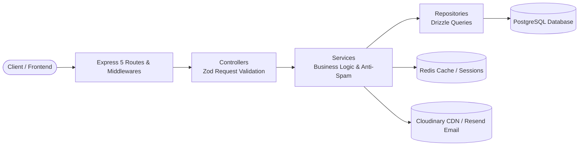

<div align="center">

# 🖋️ Inkly API

**پلتفرم مدرن و ماژولار انتشار محتوا و وبلاگ‌نویسی (Headless Blogging Platform)**  
توسعه‌یافته با بالاترین استانداردهای معماری تمیز در **Express 5**، **TypeScript** و **Drizzle ORM**

[](https://www.typescriptlang.org/)
[](https://expressjs.com/)
[](https://orm.drizzle.team/)
[](https://redis.io/)
[](https://cloudinary.com/)
[](https://resend.com/)
[](https://www.docker.com/)
[](https://www.usebruno.com/)

</div>

---

## 📖 معرفی پروژه (Overview)

**Inkly** یک زیرساخت بک‌اند پرسرعت، تایپ‌سیف و مقیاس‌پذیر برای پلتفرم‌های انتشار مقاله، شبکه‌های اجتماعی نویسندگان و سیستم‌های مدیریت محتوا (CMS) است. این پروژه با تفکیک دقیق لایه‌ها و الگوهای طراحی مدرن، تمام سناریوهای مورد نیاز یک اپلیکیشن Enterprise را از احراز هویت دوعاملی تا مکانیزم‌های ضد اسپم و سیستم مدیریت رسانه ابری فراهم می‌کند.

---

## 🏛️ معماری و الگوی لایه‌بندی (Clean Architecture)

تمامی ماژول‌ها از الگوی استاندارد و مستقل **Routes → Controller → Service → Repository → Database** پیروی می‌کنند:



### 💎 ویژگی‌های شاخص فنی

- **تایپ‌سیف ۱۰۰٪ (End-to-End Type Safety):** استفاده از تایپ‌چک بسیار سخت‌گیرانه (`exactOptionalPropertyTypes`, `noUncheckedIndexedAccess`).
- **کنترل و اعتبارسنجی ورودی‌ها:** تعریف اسکیمای تمام پارامترها، کوئری‌ها و بدنه‌های درخواست با **Zod**.
- **مدیریت خطای متمرکز (Centralized Error Handling):** سلسله‌مراتب خطاهای اختصاصی (`AppError`, `NotFoundError`, `ConflictError`, `AuthorizationError`, `DatabaseError`).
- **سیستم ورود و نشست امن:** امضای توکن‌های JWT با الگوریتم HS256، چرخش رفرش‌توکن‌ها (Refresh Token Rotation)، و ذخیره در کوکی‌های امن HttpOnly.
- **ثبت بازدید ضد اسپم (Anti-Spam Views Engine):** سیستم کش دوبخشی ردیس برای جلوگیری از ثبت مکرر بازدید مقالات به تفکیک آی‌پی کاربران مهمان و شناسه کاربران لاگین‌شده.
- **دیدگاه‌های درختی (Threaded Comments):** معماری سلف‌رفرنس دیتابیس برای پشتیبانی از پاسخ‌های چندسطحی.

---

## 📦 ماژول‌های پیاده‌سازی شده (13 Modules)

| #   | ماژول             | پیشوند روت              | توضیحات و امکانات کلیدی                                                       |
| --- | ----------------- | ----------------------- | ----------------------------------------------------------------------------- |
| 1   | **Auth**          | `/api/v1/auth`          | ثبت‌نام، تایید ایمیل، ورود، خروج، بازیابی پسورد، چرخش توکن‌های رفرش و سشن‌ها  |
| 2   | **Categories**    | `/api/v1/categories`    | ایجاد و مدیریت دسته‌بندی مقالات به همراه اسلاگ منحصربه‌فرد                    |
| 3   | **Posts**         | `/api/v1/posts`         | چرخه حیات مقالات (`DRAFT` ➔ `PENDING_REVIEW` ➔ `PUBLISHED`)، آپلود کاور و سئو |
| 4   | **Tags**          | `/api/v1/tags`          | برچسب‌گذاری مقالات با ارتباط چند-به-چند (`post_tags`)                         |
| 5   | **Comments**      | `/api/v1/comments`      | دیدگاه‌های سلسله‌مراتبی (Parent/Child Replies) روی مقالات                     |
| 6   | **Likes**         | `/api/v1/likes`         | لایک و آن‌لایک مقالات، دریافت لیست لایک‌کنندگان و استعلام وضعیت               |
| 7   | **Bookmarks**     | `/api/v1/bookmarks`     | نشان‌کردن مقالات و ذخیره در لیست مطالعه شخصی کاربر                            |
| 8   | **Follows**       | `/api/v1/follows`       | دنبال کردن نویسندگان، مشاهده لیست دنبال‌کنندگان و دنبال‌شوندگان               |
| 9   | **Users**         | `/api/v1/users`         | مدیریت حساب کاربری، ویرایش بیوگرافی، آپلود آواتار و پروفایل عمومی نویسنده     |
| 10  | **Notifications** | `/api/v1/notifications` | صندوق اعلان‌های کاربردی (لایک، کامنت، دنبال‌کننده و بازبینی پست)              |
| 11  | **Views**         | `/api/v1/views`         | ثبت بازدید هوشمند با مکانیزم Debounce ردیس (یک‌بار در ساعت برای هر IP/کاربر)  |
| 12  | **Reports**       | `/api/v1/reports`       | سیستم ثبت تخلف روی پست، دیدگاه یا کاربر به همراه پنل بررسی ادمین              |
| 13  | **Media**         | `/api/v1/media`         | مدیریت رسانه‌های ابری، آپلود به Cloudinary، ویرایش متادیتا و حذف فیزیکی       |

---

## 🛠️ جعبه ابزار و تکنولوژی‌ها (Tech Stack)

- **هسته وب و سرور:** Express 5.2, Node.js, TypeScript 5.x, TSX
- **پایگاه داده و ابزار ORM:** PostgreSQL, Drizzle ORM, Drizzle Kit
- **کش و ذخیره‌سازی موقت:** Redis 7 (Alpine), Docker Compose
- **امنیت و احراز هویت:** Argon2 (Password Hashing), Jose (JWT HS256), Cookie-Parser
- **سرویس‌های ابری:** Cloudinary (آپلود رسانه), Resend (ارسال ایمیل‌های تراکنشی)
- **پردازش فایل:** Multer (Memory Storage)
- **لاگر سرور:** Pino & Pino-Pretty

---

## 🚀 راهنمای راه‌اندازی محلی (Getting Started)

### پیش‌نیازها

- نصب **Node.js** (نسخه ۲۰ به بالا)
- نصب **Docker** و **Docker Compose**
- یک پایگاه داده **PostgreSQL** محلی یا ابری (مانند Neon یا Supabase)

### ۱. کلون کردن ریپازیتوری

```bash
git clone https://github.com/your-username/inkly.git
cd inkly
```

### ۲. نصب پکیج‌ها

```bash
npm install
```

### ۳. تنظیم متغیرهای محیطی

یک فایل `.env` بر اساس `.env.example` در ریشه پروژه ایجاد کرده و متغیرها را پر کنید:

```bash
cp .env.example .env
```

### ۴. اجرای سرویس Redis با داکر

```bash
npm run infra:up
```

### ۵. اعمال مایگریشن‌های دیتابیس

```bash
npm run db:migrate
```

### ۶. اجرای پروژه در محیط توسعه (Dev Mode)

```bash
npm run dev
```

سرور به صورت زنده روی آدرس `http://localhost:3000` آماده به کار خواهد بود.

---

## 🧪 مستندات و تست کامل با Bruno (API Collection)

کل پروژه به همراه تمام تست‌ها، سناریوهای خطا (`400`, `401`, `403`, `404`, `409`) و نمونه پاسخ‌های موفق درون پوشه **`inkly-api-bruno/`** قرار دارد.  
کافیست نرم‌افزار **[Bruno](https://www.usebruno.com/)** را باز کرده و پوشه `inkly-api-bruno` را به عنوان Collection باز کنید:

- دسته‌بندی منظم در **۱۳ پوشه مجزا**
- متغیرهای محیطی تنظیم‌شده (`{{base_url}}`, `{{accessToken}}`)
- راهنمای کامل و مستندات مارک‌داون اختصاصی در تب **Docs** هر ریکوئست

---

## 📜 اسکریپت‌های کاربردی پروژه

| دستور                 | کاربرد                                                |
| --------------------- | ----------------------------------------------------- |
| `npm run dev`         | اجرای برنامه در محیط توسعه همراه با Hot Reload        |
| `npm run typecheck`   | بررسی کامل سلامت تایپ‌های تایپ‌اسکریپت بدون بیلد      |
| `npm run build`       | کامپایل کدهای پروژه به جاوااسکریپت برای محیط پروداکشن |
| `npm run db:generate` | ساخت مایگریشن جدید بر اساس تغییرات اسکیما             |
| `npm run db:migrate`  | اجرای مایگریشن‌ها روی دیتابیس                         |
| `npm run db:studio`   | باز کردن محیط بصری Drizzle Studio برای مشاهده داده‌ها |
| `npm run infra:up`    | راه‌اندازی کانتینر ردیس با داکر کامپوز                |
| `npm run infra:down`  | خاموش کردن کانتینر ردیس                               |

---

## 👨‍💻 توسعه‌دهنده

ساخته شده با ❤️ و وسواس در جزئیات توسط **مهدی**
