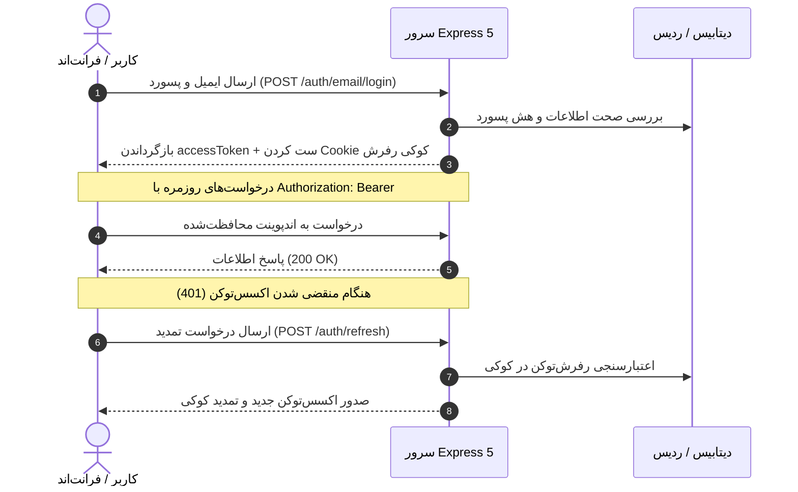

# 🔐 احراز هویت و نشست‌ها (Authentication & Security)

سامانه اینکلی از سیستم احراز هویت ترکیبی **JWT Access Token + Refresh Token Rotation** برای برقراری بیشترین سطح امنیت و تجربه کاربری بدون وقفه استفاده می‌کند.

---

## 🔑 سازوکار توکن‌ها (Token Mechanism)

1. **Access Token (توکن دسترسی):**
   - یک توکن منقضی‌شونده سریع (۱۵ دقیقه) با فرمت JWT است.
   - پس از ورود موفق، در پاسخ دریافتی به کلاینت تحویل داده می‌شود.
   - باید در هدر تمام درخواست‌های محافظت‌شده ارسال شود:
     ```http
     Authorization: Bearer <ACCESS_TOKEN>
     ```

2. **Refresh Token (توکن بازنشانی):**
   - یک شناسه امن با طول عمر بلندمدت (۳۰ روز).
   - به منظور جلوگیری از حملات XSS، در کوکی‌های امن و محافظت‌شده **`HttpOnly`** ذخیره می‌شود و جاوااسکریپت فرانت‌اند دسترسی مستقیمی به آن ندارد.
   - از مکانیزم **چرخش توکن (Token Rotation)** استفاده می‌کند؛ یعنی با هر بار درخواست رفرش، توکن قبلی باطل و یک توکن نو جایگزین می‌شود.

---

## 🎭 سطوح دسترسی و نقش‌های کاربری (User Roles)

کاربران در سامانه دارای یکی از سه نقش زیر هستند:

| نقش      | دسترسی‌ها                                                                                                                          |
| -------- | ---------------------------------------------------------------------------------------------------------------------------------- |
| `USER`   | کاربران عادی: ثبت نظر، لایک، بوکمارک، دنبال‌کردن نویسندگان و ثبت گزارش تخلف.                                                       |
| `AUTHOR` | نویسندگان: تمام دسترسی‌های کاربر عادی + نوشتن مقاله، ارسال مقاله برای بازبینی، مدیریت تگ‌ها و کتابخانه رسانه‌ها.                   |
| `ADMIN`  | مدیران سامانه: دسترسی نامحدود به تمام بخش‌ها، تایید یا رد مقالات نویسندگان، بررسی گزارش‌های تخلف، تغییر نقش‌ها و حذف محتوای متخلف. |

---

## 🔄 سناریوی احراز هویت در فرانت‌اند


